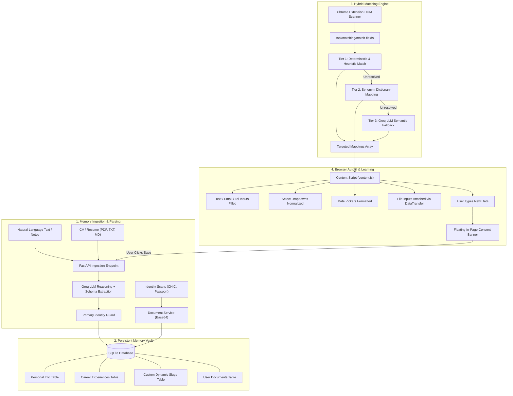

# Magic Fill — Technical Architecture & Comprehensive System Documentation

> **Magic Fill** is an AI-powered personal memory vault and intelligent browser autofill platform. It transforms unstructured notes, resumes, and identification documents (e.g., CNIC, Passport) into a grounded, structured relational database, and autonomously maps and fills complex web forms via a Chromium browser extension.

---

## 1. Executive Summary & Problem Statement

### The Problem
Traditional browser autofill tools (like Chrome or Safari autofill) are rigid, fragile, and lack semantic understanding:
1. **Name Collisions & Hallucination**: Typing *"My friend's name is Taha"* often causes basic autofill to overwrite the user's legal first name with "Taha".
2. **Inability to Handle Complex Fields**: Standard autofill fails on custom forms requiring specific fields (e.g., emergency contact, father's name, roll numbers, degrees, or dynamic custom attributes).
3. **No Support for File/Image Uploads**: Web forms requiring CNIC front/back scans, passport photos, or resumes cannot be automated by standard browser autofill.
4. **Lack of Dynamic Learning**: When a user enters new information into a job portal or admission form, standard browsers discard it instead of learning and offering to save it.

### The Magic Fill Solution
Magic Fill solves this through a **three-tier architecture**:
* **Grounded Memory Vault**: An encrypted, persistent relational database (SQLite + SQLAlchemy) acting as a single source of truth.
* **Hybrid Matching & Extraction Engine**: Combines deterministic heuristic matching, synonym dictionaries, and Groq LLM semantic reasoning (`openai/gpt-oss-120b` / Llama 3.3).
* **Cross-Origin Chromium Extension**: An active DOM inspector and autofill agent (Manifest V3) that inspects web pages, triggers synthetic React/Vue/Angular change events, autofills file inputs, and learns new data dynamically.

---

## 2. High-Level System Architecture

The following diagram illustrates the complete end-to-end data flow of Magic Fill:



---

## 3. Core Modules & Component Deep Dive

### 3.1 Backend Core (`backend/app/`)

The backend is built with **FastAPI**, **SQLAlchemy ORM**, **Pydantic v2**, and **SQLite**.

#### A. Database Schema (`app/database/models.py`)
* **`User`**: Root entity storing account metadata (`id`, `created_at`, `updated_at`).
* **`PersonalInfo`**: Primary biographical data (`full_name`, `father_name`, `gender`, `date_of_birth`, `cnic`, `phone`, `email`, `address`, `city`, `country`, `profile_photo`).
* **`Experience`**: Relational list of career positions (`company`, `role`, `start_date`, `end_date`, `description`, `skills`).
* **`CustomField`**: Dynamic key-value store for arbitrary attributes (e.g. `friends_name`, `emergency_contact`, `blood_group`). Uses unique compound indexing `(user_id, field_key)`.
* **`UserDocument`**: Binary file and media store (`title`, `doc_key`, `description`, `file_name`, `mime_type`, `file_data`, `file_size_bytes`). Stored as self-contained Base64 Data URIs (`data:image/jpeg;base64,...`).

#### B. Primary Identity Guard (`app/services/extraction_service.py`)
A core innovation of Magic Fill is the **Identity Shield**:
* When a user inputs auxiliary contacts or references (e.g. *"Friends Name is Taha"* or *"Emergency contact Brother Usman"*), the extraction pipeline detects whether the text describes the **primary user** or an **auxiliary third party**.
* If it is a third party, it maps into `custom_fields` with slug `friends_name = "Taha"` and explicitly **protects** `personal_info.full_name` from being corrupted or overwritten.

#### C. The Three-Tier Hybrid Matching Engine (`app/services/matching_service.py`)
When a web page is scanned, field metadata (name, id, label, placeholder, aria-label, input type, dropdown options) is sent to `/api/matching/match-fields`:
1. **Tier 1 — Deterministic Rule Engine**:
   * Evaluates exact keys, normalized regex patterns, and fuzzy attributes.
   * Recognizes standard fields: `first_name`, `last_name`, `full_name`, `email`, `phone`, `cnic`, `dob`, `gender`, `city`, `country`.
   * High confidence (1.0), near-zero latency (~2ms).
2. **Tier 2 — Synonym Dictionary Mapping**:
   * Matches real-world portal discrepancies:
     * `institution` / `college` / `school` $\rightarrow$ maps to `university`
     * `organization` / `employer` / `workplace` $\rightarrow$ maps to `company`
     * `designation` / `position` $\rightarrow$ maps to `role`
   * High confidence (0.95).
3. **Tier 3 — Groq LLM Semantic Fallback**:
   * For ambiguous forms or non-standard naming conventions (e.g., custom job questions, dynamic slugs), the engine sends the unresolved field prompts and stored vault keys to Groq LLM with strict JSON schema instructions.
   * Maps fields semantically without hallucinations.

---

### 3.2 Web Studio Dashboard (`backend/web/`)

The Studio is a single-page web workstation built with Vanilla CSS and modern JavaScript:
* **Zero Overhead**: Served directly by FastAPI via `StaticFiles(directory="web")` at `http://127.0.0.1:8000/`. No separate Node.js server needed.
* **Light Theme Design System**: `#f8fafc` canvas, pure white `#ffffff` cards, hairline `#e2e8f0` borders, deep slate `#0f172a` typography, and electric indigo `#4f46e5` accent.

#### Studio Workspace Tabs:
1. **Tab 1: Ingestion Studio**
   * Multi-line natural language text area + CV file attachment dropzone.
   * Real-time character/word counter.
   * **Process Button**: Extracts structured schema via Groq AI, highlights identity protection status, and displays formatted JSON inspector.
2. **Tab 2: Photos & Documents Studio**
   * Drag-and-drop document uploader supporting PNG, JPG, PDF, SVG.
   * Written description input (e.g., *"this is my cnic front"* $\rightarrow$ auto-classifies as `cnic_front`).
   * **Saved Media Gallery**: Filterable by Identity, Photographs, and Academic records with click-to-zoom Lightbox modal and clipboard Data URI copying.
3. **Tab 3: Personal Memory Vault**
   * Searchable, category-filtered database explorer (Biographical, Contact, Academic, Custom, Documents, Career).
   * In-place value editing with instant database synchronization.
   * Dynamic Custom Field creator drawer (`field_key`, `field_label`, `field_value`).
4. **Tab 4: Autofill Simulator & Playground**
   * Real-world application form replicating complex job/university admission portals.
   * Includes legal names, dropdown menus (Gender, Country), HTML5 Date pickers, career milestones, custom dynamic attributes (`friends_name`, `personal_mail`), and multi-file attachment inputs (`profile_photo`, `cnic_front`, `cnic_back`, `passport`).
   * Demonstrates synthetic DOM event dispatching and image attachment simulation.

---

### 3.3 Chromium Browser Extension (`extension/`)

The browser extension enables Magic Fill to operate across any website on the internet:

* **`manifest.json` (Manifest V3)**:
  * Permissions: `activeTab`, `storage`, `scripting`.
  * Host permissions: `http://127.0.0.1:8000/*` and `http://localhost:8000/*`.
  * Configured with official 16px, 48px, 128px magic wand icons.
* **`popup/` (Extension UI)**:
  * Minimalist Light-Mode popup displaying active backend connection health, profile identity snapshot, live vault metrics (Docs, Custom, Career), one-click **Autofill Current Form**, and field mapping preview.
* **`scripts/background.js` (Service Worker)**:
  * Coordinates background message passing between extension tabs and the FastAPI backend.
* **`scripts/content.js` (DOM Agent)**:
  * **Page Scanner (`scanFormFields`)**: Recursively inspects visible inputs, detects associated `<label>` tags, placeholders, ARIA attributes, and dropdown `<option>` arrays. Excludes sensitive inputs (e.g., passwords).
  * **Autofill Dispatcher (`applyAutofill`)**: Injects matched values and fires synthetic `input` and `change` events (`dispatchEvent(new Event('change', { bubbles: true }))`), guaranteeing compatibility with reactive frameworks (React, Angular, Vue).
  * **Binary File Ingestion via `DataTransfer`**: Decodes Base64 data from memory and instantiates synthetic `File` objects inside native file inputs.
  * **In-Page Continuous Learning (`showConsentBanner`)**: Monitors user typing on external websites. If new information is detected, it renders an in-page floating consent card asking: *"Would you like to save this to your personal memory vault?"*

---

## 4. Step-by-Step Execution Workflows

### Scenario 1: Natural Language Memory Ingestion
1. User types in Tab 1: `"Friends Name is Taha and my personal email is muazam.dev@gmail.com"`.
2. User clicks **Process**.
3. FastAPI endpoint `/api/memory/extract-raw` triggers `extraction_service.py`.
4. Groq LLM parses the sentence into structured Pydantic schema:
   * `personal_info`: `{ "email": "muazam.dev@gmail.com" }`
   * `custom_fields`: `[ { "field_key": "friends_name", "field_label": "Friend's Name", "field_value": "Taha" } ]`
5. Database engine executes `upsert`:
   * Updates `personal_info.email` for User #1.
   * Inserts/updates `friends_name` in `custom_fields`.
   * Leaves `personal_info.full_name` untouched (Protected Identity).

### Scenario 2: Document / Photo Upload
1. User uploads `cnic_front.jpg` in Tab 2 and writes: `"This is my CNIC front"`.
2. Browser encodes the file to Base64 Data URI (`data:image/jpeg;base64,...`).
3. Payload is sent to `/api/documents`.
4. Engine classifies `doc_key = "cnic_front"`, stores it in `user_documents`, and updates User #1's active cache.
5. In Tab 4 (or on an external site), when an input named `cnic_front` is detected, the extension retrieves the Data URI, converts it to a synthetic `File` object via `DataTransfer`, and attaches it directly to the form's file input.

### Scenario 3: Autonomous Form Filling on an External Website
1. User navigates to any third-party form (e.g., job application or visa portal).
2. User clicks the **Magic Fill** extension icon and clicks **Autofill Current Form**.
3. `content.js` scans all fields and sends metadata to `/api/matching/match-fields`.
4. The hybrid matching engine matches text inputs, maps dropdown choices (e.g., `"Male"` $\rightarrow$ `"M"`), formats date pickers (`YYYY-MM-DD`), and assigns document Data URIs.
5. `content.js` populates the fields, triggers synthetic events, and displays a success notification with the total count of filled fields.

---

## 5. Security, Grounding & Privacy Principles

| Principle | Implementation |
| :--- | :--- |
| **Zero Hallucination** | LLM output is strictly validated against Pydantic schema models (`app/schemas/`). If an LLM response deviates, deterministic heuristic fallback takes over. |
| **Primary Identity Shielding** | Contact references and third-party names are diverted into isolated `custom_fields` records to protect primary legal identities. |
| **Explicit Consent for Learning** | Data entered into forms is never saved automatically without the user actively clicking **Save to Memory** on the floating consent banner. |
| **Local-First & Offline Backups** | All records and Base64 images are stored locally in `backend/personal_memory.db`. Backups are 100% self-contained JSON files with zero external hosting dependencies. |

---

## 6. How to Run & Verify the System

### 6.1 Running the Server
From the project root (`Magic_Fill`), run any of the following:

* **Option A (Double-Click)**: Double-click `run.bat` in File Explorer.
* **Option B (Python Command)**:
  ```powershell
  python run.py
  ```
* **Option C (PowerShell Script)**:
  ```powershell
  .\run.ps1
  ```

> Open your browser at: **`http://127.0.0.1:8000/`**

### 6.2 Running Automated Test Suites
Run the 40-test automated suite using `pytest`:
```powershell
backend\.venv\Scripts\pytest.exe backend\tests\ -v
```
**Test Coverage Includes:**
* `test_health.py`: Database connection & server health.
* `test_memory.py`: Extraction, memory persistence, and identity protection.
* `test_matching.py`: Deterministic, synonym, and LLM semantic form matching.
* `test_personal_info.py`: Biographical CRUD and validation.
* `test_custom_fields.py`: Dynamic slug upserting and duplicate handling.
* `test_documents.py`: Document upload, classification, and deletion.
* `test_experiences.py`: Career milestone serialization.

### 6.3 Loading the Extension in Chromium (Chrome / Edge)
1. Navigate to `chrome://extensions/` (or `edge://extensions/`).
2. Enable **Developer mode** (top-right toggle).
3. Click **Load unpacked** and select the `Magic_Fill\extension` directory.
4. Click the **Magic Fill** icon in your browser toolbar to use.
